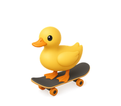

 

### Hi, I’m Júlia Martins

Senior product designer by day, living in Figma. 
Vibe coder by night, pairing with AI. 
Exploring where design and code meet: Figma to code, motion and small apps. 
 
[Portfolio](https://juliamartins.netlify.app) · [LinkedIn](https://www.linkedin.com/in/juliamartinsux)

 
